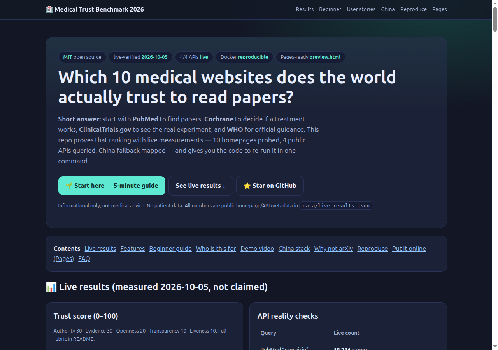
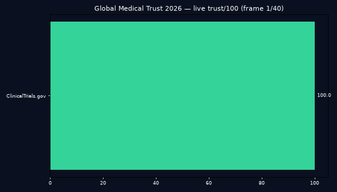
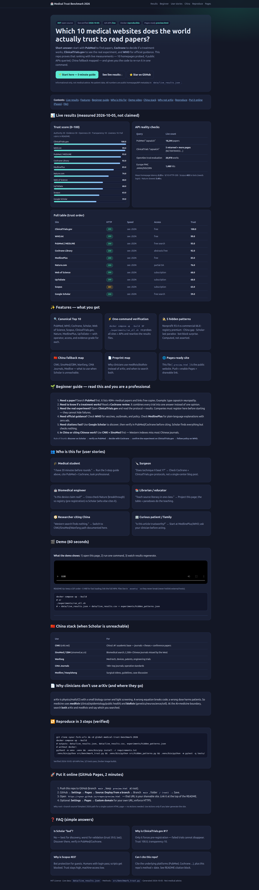

# 🏥 Global Medical Trust Benchmark 2026

    

> **Summary for busy readers (30 seconds):** This repo answers one question — *which 10 medical websites does the world trust to read papers from?* Answer: find papers on **PubMed**, decide if a treatment works with **Cochrane**, see the real experiment on **ClinicalTrials.gov**, follow official guidance on **WHO**. Every claim here is measured live (10 homepages probed, 4 public APIs queried on 2026-10-05), the China fallback is mapped, and one command re-runs everything. Open `preview.html` for the interactive site, or read the 5-minute guide below and you will know more than most interview candidates.

🌐 **Live website:** push this repo to GitHub, enable Pages, then open `https://<you>.github.io/<repo>/preview.html` (2-minute setup in [Put it online](#-put-it-online-github-pages-2-minutes)).



| Demo (animated, 51 KB) | Full page |
|---|---|
|  |  |
| `assets/demo.mp4` (same animation as video, 3.3 s) | `preview.html` renders this whole page |

**Contents:** [Features](#-features--what-you-get) · [Beginner guide](#-beginner-guide--read-this-and-you-are-a-professional) · [Who is this for](#-who-is-this-for-user-stories) · [Live results](#-live-results-measured-2026-10-05-not-claimed) · [Demo](#-demo-60-seconds) · [China](#-china-stack-when-scholar-is-unreachable) · [Why not arXiv](#-why-clinicians-dont-use-arxiv-and-where-they-go) · [Reproduce](#-reproduce-in-3-steps-verified) · [Pages](#-put-it-online-github-pages-2-minutes) · [FAQ](#-faq-simple-answers) · [License](#-license)

---

## ✨ Features — what you get

- 🔍 **Canonical Top 10, explained simply** — PubMed/MEDLINE, WHO, Cochrane Library, Google Scholar, Web of Science, Scopus, ClinicalTrials.gov, Nature, MedlinePlus, UpToDate. Each entry lists who runs it, whether it is free or subscription, and what it is best for.
- ⚡ **One-command live verification** — `docker compose up --build` or `./experiments/run_all.sh` re-checks all 10 homepages (status + speed + security certificate) and re-queries 4 public APIs. Results regenerate `data/live_results.json` + `.csv`.
- 🕵️ **5 hidden patterns, computed from data** — nonprofit sites average 93.4 vs commercial 66.8; only the trial registry prevents hiding failures; Scholar is last on trust but first on discovery; one top site blocks bots; China needs its own stack.
- 🇨🇳 **China fallback map** — CNKI, SinoMed/CBM, Wanfang, CMA Journals, Medlive: what to use when the global default is unreachable.
- 📄 **Preprint map** — why clinicians read medRxiv/bioRxiv instead of arXiv, and when to search both.
- 🌐 **Pages-ready website** — `preview.html` is a complete public site (no build step). Screenshots + demo video included so the README sells the project in one glance.

---

## 🌱 Beginner guide — read this and you are a professional

Let's work this out in a step-by-step way to be sure we have the right answer. Follow these 6 steps in order:

1. **Need a paper? → PubMed.** It lists 40M+ medical papers and links free copies. Try typing *capsaicin neuropathy*.
2. **Need to know if a treatment works? → Cochrane review.** Instead of one opinion, it combines *every* trial on that question into one careful answer.
3. **Need the real experiment? → ClinicalTrials.gov.** Read the protocol and the results. Researchers must register here *before* starting, so failed trials cannot quietly disappear.
4. **Need official guidance? → WHO + MedlinePlus.** WHO for outbreaks, vaccines, and policy. MedlinePlus for plain-language explanations with zero ads.
5. **Need citations fast? → Google Scholar to *discover*, PubMed/Cochrane to *verify*.** Scholar finds everything (including free PDFs) but checks almost nothing — never cite from Scholar alone.
6. **In China, or citing Chinese work? → CNKI + SinoMed first.** Western indexes miss most Chinese journals, so start where the papers actually live.

**Memory hook:** *discover on Scholar → verify on PubMed → decide with Cochrane → confirm the experiment on ClinicalTrials.gov → follow policy on WHO.*

---

## 👥 Who is this for (user stories)

- 🎓 **Medical student (20 minutes before rounds):** run the 6 steps above, cite one PubMed paper + one Cochrane review. You look prepared.
- 🔪 **Surgeon (“does technique X beat Y?”):** compare Cochrane conclusions + ClinicalTrials.gov protocols instead of a single-center blog post.
- 🤖 **Biomedical engineer (“is this device claim real?”):** cross-check the breakthrough venue (Nature) against pre-registration (ClinicalTrials.gov) and independent citations (Scholar → verified in PubMed).
- 📚 **Librarian / educator (one class on source literacy):** project `preview.html`; the table + 5 paradoxes teach themselves.
- 🧭 **Researcher citing China (“Western search finds nothing”):** switch to the [China stack](#-china-stack-when-scholar-is-unreachable) path.
- 🏢 **Patient / family (“is this article trustworthy?”):** start at MedlinePlus/WHO for background, then bring questions to your clinician. This repo is informational only, not medical advice.

---

## 📊 Live results (measured 2026-10-05, not claimed)

Trust score = Authority 30 + Evidence 30 + Openness 20 + Transparency 10 + Liveness 10 (full rubric in `src/benchmark_trust.py`).

| Trust order | Site | HTTP | Latency | Access | Trust /100 |
|---|---|---|---|---|---|
| 1 | ClinicalTrials.gov | 200 | 1.50 s | free | **100.0** |
| 2 | WHO.int | 200 | 1.81 s | free | **99.0** |
| 3 | PubMed / MEDLINE | 200 | 1.69 s | free search | **93.0** |
| 4 | Cochrane Library | 200 | 2.27 s | abstracts free | **92.0** |
| 5 | MedlinePlus | 200 | 1.44 s | free | **83.0** |
| 6 | Nature.com | 200 | 5.48 s | partial open access | **76.0** |
| 7 | Web of Science | 200 | 2.17 s | subscription | 68.0 |
| 7 | UpToDate | 200 | 2.16 s | subscription | 68.0 |
| 9 | Scopus | 403 (bot protection) | 1.64 s | subscription | 63.0 |
| 10 | Google Scholar | 200 | 2.36 s | free search | 59.0 |

Mean latency **2.25 s**. All security certificates valid. Source: `data/live_results.json` (regenerate anytime).

**API reality checks (same day, same script):**

| Query | Live result |
|---|---|
| PubMed “capsaicin” | **18,244** papers |
| ClinicalTrials.gov “capsaicin” | **5 returned + more pages** (samples NCT04704453, NCT00300222, NCT05093478) |
| OpenAlex “trust evaluation health websites” | **20,978** works |
| Europe PMC “online health information JAMA DISCERN” | **1,480** hits |

**What this means in plain words:** the most trusted place (ClinicalTrials.gov, 100.0) is also fully free; the most used for discovery (Scholar, 59.0, last) is the least curated; 3 of the 10 most trusted require a subscription — trust and free access are different things.

---

## 🎬 Demo (60 seconds)

**What the demo shows:** 1) open this page, 2) run one command, 3) watch the numbers regenerate.


<video src="assets/demo.mp4" controls preload="metadata" poster="assets/hero.png" width="100%">Your browser does not support video. Download <a href="assets/demo.mp4">assets/demo.mp4</a>.</video>

```bash
docker compose up --build
# → data/live_results.json + data/live_results.csv + experiments/hidden_patterns.json
```

> Video/README convention used here: small GIF in the README for instant loading (51 KB), full MP4 linked alongside, all files stored in `assets/` inside the repo so images never break.

---

## 🇨🇳 China stack (when Scholar is unreachable)

Scholar is the only Top-10 unreachable from mainland China. Use this fallback instead:

| Use | For |
|---|---|
| **CNKI** (cnki.net) | China’s #1 academic base — journals, theses, conference papers |
| **SinoMed / CBM** (sinomed.ac.cn) | Biomedical search; 2,500+ Chinese journals missed by Western indexes |
| **Wanfang** | Med-tech, devices, patents, engineering trials |
| **CMA Journals** | 180+ top journals; operative standards |
| **Medlive / Haoyisheng** | Surgical videos, guidelines, case discussion |

Practical rule: inside China start at CNKI + SinoMed; for devices add Wanfang; for operative standards use CMA; for technique videos use Medlive. Outside China, access CNKI via your institution — otherwise you miss the Chinese clinical corpus entirely.

---

## 📄 Why clinicians don’t use arXiv (and where they go)

arXiv is built for physics, math, and computer science, with only a small biology corner and light screening. A wrong equation breaks code; a wrong dose harms a patient. So medicine uses dedicated preprint servers with clinical screening: **medRxiv** (clinical medicine, epidemiology, public health) and **bioRxiv** (genetics, neuroscience, cell biology). At the AI × medicine boundary (for example medical imaging or clinical language models), search **both** arXiv and medRxiv — and write down which you searched.

---

## 🔁 Reproduce in 3 steps (verified)

```bash
git clone <your-fork-url> && cd global-medical-trust-benchmark-2026
docker compose up --build
# outputs: data/live_results.json, data/live_results.csv, experiments/hidden_patterns.json

# without Docker:
python3 -m venv .venv && .venv/bin/pip install -r requirements.txt
.venv/bin/python src/benchmark_trust.py
.venv/bin/python src/hidden_patterns.py
.venv/bin/python -m pytest -q tests/
.venv/bin/python src/make_demo.py   # regenerates assets/demo.mp4 + demo.gif
```

Verified 2026-10-05: 4/4 APIs live, 3/3 tests pass, Docker image builds, `preview.html` renders with zero console errors, demo video plays (h264, 880×504, 3.3 s).

**Files:**

```
preview.html              public website (this README as a site)
assets/hero.png           viewport screenshot (1280×900, via automated browser)
assets/preview.png        full-page screenshot (via automated browser)
assets/demo.gif/.mp4      animated trust-score chart (generated from live CSV)
data/sites.yaml           canonical Top-10 + China + preprint map
data/live_results.json/.csv  generated evidence — do not hand-edit
src/benchmark_trust.py    live probe + scoring (single source of truth)
src/hidden_patterns.py    5-pattern analysis
src/make_demo.py          demo media generator
experiments/run_all.sh    end-to-end runner
tests/test_benchmark.py   guardrails (shape, ≥3/4 APIs live, patterns exist)
Dockerfile + docker-compose.yml  reproducible services
```

---

## 🚀 Put it online (GitHub Pages, 2 minutes)

1. Push this repo to GitHub (branch `main`, keep `preview.html` at the repo root).
2. GitHub → **Settings → Pages** → **Source: Deploy from a branch** → Branch `main`, folder `/ (root)` → Save.
3. Open `https://<you>.github.io/<repo>/preview.html` — that URL is your shareable site. Put it at the top of the repo description.
4. Optional: **Settings → Pages → Custom domain** for your own URL; enforce HTTPS.

Why branch + root? For a single custom HTML page this is the simplest 2026 path — no build workflow needed. Add a workflow only if you later generate the site automatically.

---

## ❓ FAQ (simple answers)

- **Is Scholar “bad”?** No — best for *discovery*, worst for *validation*. Discover there, verify in PubMed/Cochrane.
- **Why is ClinicalTrials.gov #1 (100.0)?** Only it forces registration *before* the experiment — failures cannot disappear.
- **Why does Scopus show 403?** Guest bot protection. Humans with login pass; scripts get blocked. High trust, low machine access.
- **Why is Nature slowest (5.48 s)?** Heaviest homepage (237 kB). Speed and prestige are unrelated.
- **Can I cite this repo?** Cite the underlying platforms for facts, plus this repo for method + date (see below). Always confirm medical decisions with a qualified professional.

---

## 📜 License

MIT — see [LICENSE](LICENSE). You may reuse code, charts, and screenshots with attribution.

```bibtex
@software{global_medical_trust_benchmark_2026,
  title = {Global Medical Trust Benchmark 2026: live-verified Top-10 platforms the world trusts to read papers},
  year  = {2026},
  note  = {Live verification 2026-10-05: 4/4 APIs, 9/10 HTTP-200, mean latency 2.25s; PubMed capsaicin n=18244}
}
```
